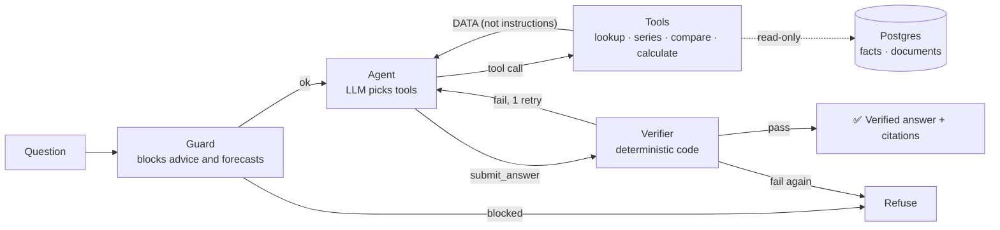

# VerifiedRAG

[](https://github.com/ChinmayLokare/verified-rag/actions/workflows/ci.yml)


**An agentic RAG system that refuses to guess.** It answers questions over SEC filings (10-K, 10-Q). Every number in an answer is traced to its source filing and checked by code before it is returned. If the system can't verify an answer, it refuses and shows the evidence it found.

A real run on a free local model:

```text
$ vrag ask "What was Nike's revenue in fiscal 2024?"
[  0.6s] guard: question is in scope
[  1.9s]   tool lookup_fact(fiscal_year=2024, company='Nike', concept='revenue')
[  2.0s]     -> ok: 1 ref(s): f_69552
[  4.7s] verify: checking 1 claim(s)
[  4.7s] verify: passed
Nike's revenue in fiscal 2024 was $51.36 billion.
  - Nike's revenue in fiscal 2024 was $51.36 billion
      f_69552: NIKE, Inc. revenue FY2024 FY
verified (2 model calls, 4.1s)
```

`f_69552` is a stored fact: 51,362,000,000 USD, from Nike's 10-K, with its XBRL tag and its period (2023-06-01 to 2024-05-31).

---

## Why

Language models are fluent but unreliable with numbers. They misremember figures, mix up fiscal years and get arithmetic wrong, and they sound confident while doing it. In finance, a confident wrong number does more harm than no answer.

VerifiedRAG keeps the model away from every step that decides correctness:

| The model **does** | Code **does** |
|---|---|
| Understand the question | Look up figures with fixed, parameterized SQL templates |
| Choose which tool to call | Do all arithmetic (`Decimal`, unit and period checks) |
| Write the final sentence | Verify every number, year and company in the answer |
| | Refuse when verification fails |

## How it works



1. **Ingest:** facts from SEC EDGAR XBRL are normalized into a `facts` table. The ingester respects rate limits, caches responses for offline re-runs, and finds and reports conflicting values. Each fact keeps its source filing, its XBRL tag and its period. When several filings report the same figure, the newest one wins.
2. **Agent:** a single, bounded tool-calling agent built with LangGraph. It has hard limits on model calls, time, cost and retries.
3. **Tools:** typed Pydantic inputs feed fixed SQL templates. **The model never writes SQL.** It reads data only through views, under a read-only role, with a statement timeout and a row cap.
4. **Calculator:** takes references to stored facts (`f_123`, `calc_4`), never raw values, so the model can't slip in a number of its own.
5. **Verifier:** checks every number in the draft answer at the precision it is written, checks that years and companies match the evidence, and re-computes every calculation. Answers that fail are never returned.

## Results

From the eval harness ([evals/](evals/)), using a **free 3B local model** (`qwen2.5:3b` via Ollama) on 20 questions generated from the database: 16 answerable and 4 that the system should refuse.

| Run | Coverage (answered ÷ answerable) | Wrong-answer rate | Correct refusals |
|---|---|---|---|
| Baseline | 19% (3/16) | **0%** | 4/4 |
| After redesigning the tools for small models ([ADR-10](docs/adr/0010-local-model-and-name-based-tools.md)) | **75% (12/16)** | **0%** | 4/4 |

When the small model struggled, the system refused instead of answering wrongly. That is the behavior it was designed for. These numbers come from a small eval set (see [evals/results/](evals/results/)). Larger benchmarks are on the roadmap.

## Engineering practices

- **Safety by design:** bound SQL parameters only, least-privilege database role, retrieved text labeled as untrusted content (a prompt-injection boundary), no secrets in the repo.
- **Testing:** 128 tests, including integration tests against a real Postgres. Agent tests run on a scripted fake model, so the suite is deterministic and makes no paid API calls.
- **Evals as regression checks:** a re-runnable harness that measures coverage and wrong-answer rate whenever prompts, models or tools change.
- **CI:** Ruff lint and format checks, strict Pyright, and pytest against a Postgres service on every push to `main` and every pull request.
- **Docs:** a [design doc](docs/design.md), [architecture decision records](docs/adr/), and a [code map](docs/code-map.md) whose diagrams are kept in sync with the code.
- **Pluggable domains:** all finance knowledge (concepts, units, connector, prompt) lives in [packs/finance/](packs/finance/), not in the core code.

## Tech stack

Python 3.12 · LangGraph · LangChain · Ollama (local) / Claude (optional) · PostgreSQL 17 + pgvector · Pydantic · psycopg 3 · Docker Compose · pytest · Ruff · Pyright · GitHub Actions · uv

## Roadmap

| | Milestone | |
|---|---|---|
| ✅ | **M0** Skeleton | Tooling, schema, forward-only migrations, CI |
| ✅ | **M1** Facts path | SEC XBRL → normalized facts → query templates + calculator |
| ✅ | **M2** Agent + verifier | LangGraph agent, deterministic verifier, refusal path, eval harness |
| 🚧 | **M3** Text path | "Why" questions answered with verified quotes from filings (pgvector + full-text search) |
| ⏳ | **M4** Evals | FinanceBench, golden set, tracing, CI quality gate |
| ⏳ | **M5** Calibration | Confidence score and refusal threshold |
| ⏳ | **M6** Production | AWS (Terraform), auth, MCP server, web UI |

## Quickstart

Requires Python 3.12, [uv](https://docs.astral.sh/uv/), Docker, and [Ollama](https://ollama.com/) for the agent.

```sh
cp .env.example .env          # set VRAG_FINANCE_SEC_USER_AGENT (SEC requires a contact)
docker compose up -d          # Postgres 17 + pgvector on localhost:5433
uv sync
uv run vrag migrate
uv run pytest

uv run vrag ingest                                   # SEC EDGAR → facts
uv run vrag lookup NKE revenue --year 2024           # exact lookup, no AI
uv run vrag calc "(a - b) / b * 100" a=f_12 b=f_9    # calculator by reference

ollama pull qwen2.5:3b
uv run vrag ask "What was Nike's revenue in fiscal 2024?"
uv run python -m evals.harness.run                   # eval run
```

## Project layout

```text
src/verified_rag/
  agent/     LangGraph graph, guard, prompts, model setup
  verify/    verifier, number parsing, evidence loading (no framework imports)
  tools/     calculator and entity/concept resolvers
  store/     migrations, read-only access, SQL templates
  ingest/    normalization and fiscal-period logic
  packs/     domain-pack interface and loader
packs/finance/   SEC connector, concepts, units, prompt
evals/           question generation, grading, runs
docs/            design, ADRs, code map
```
