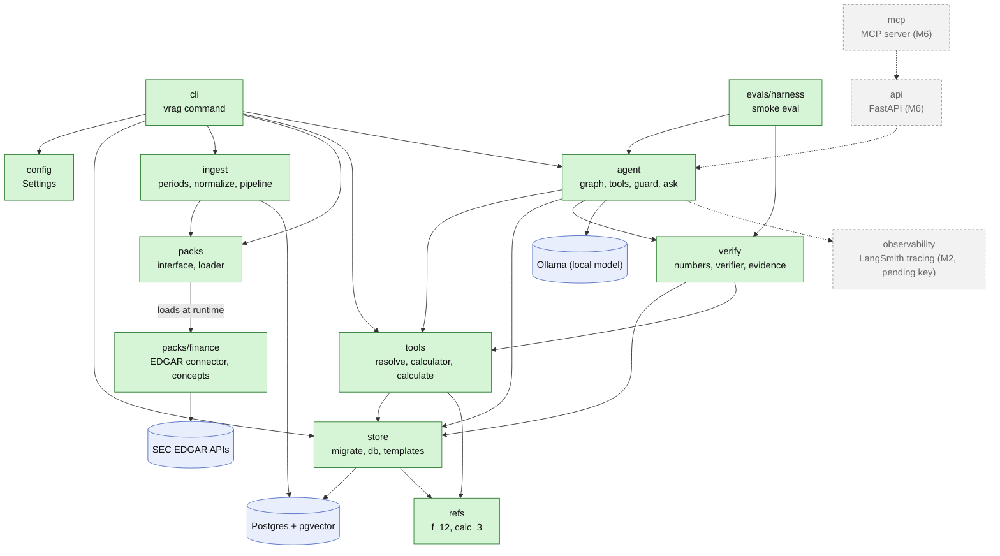
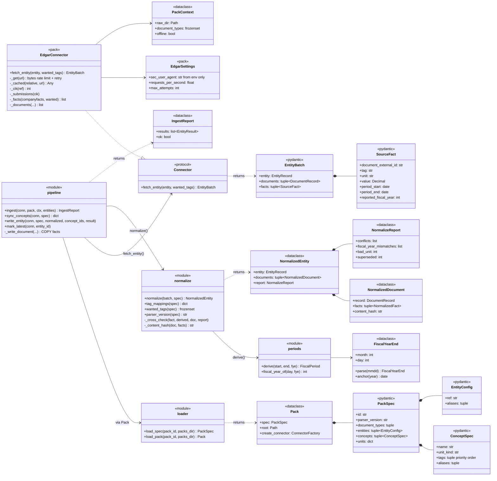
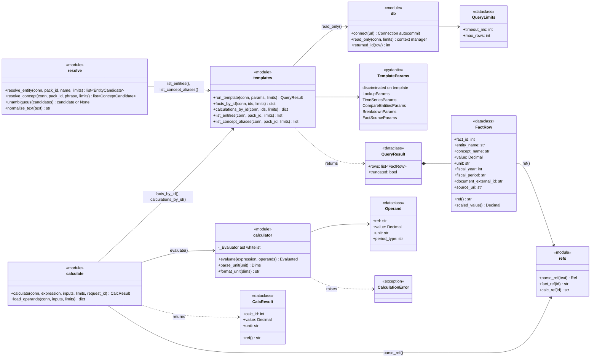
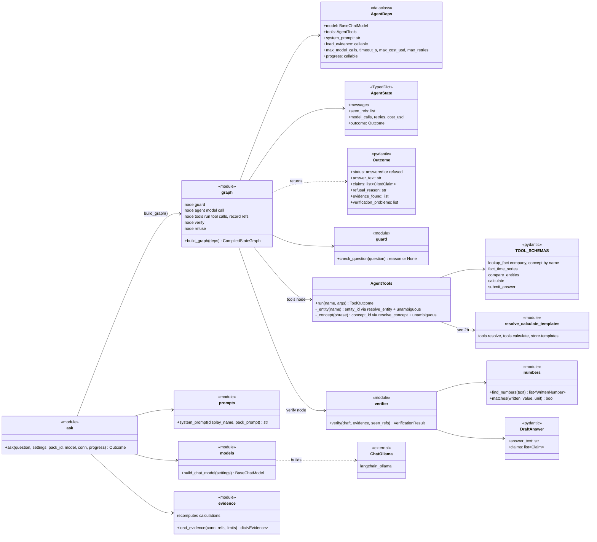
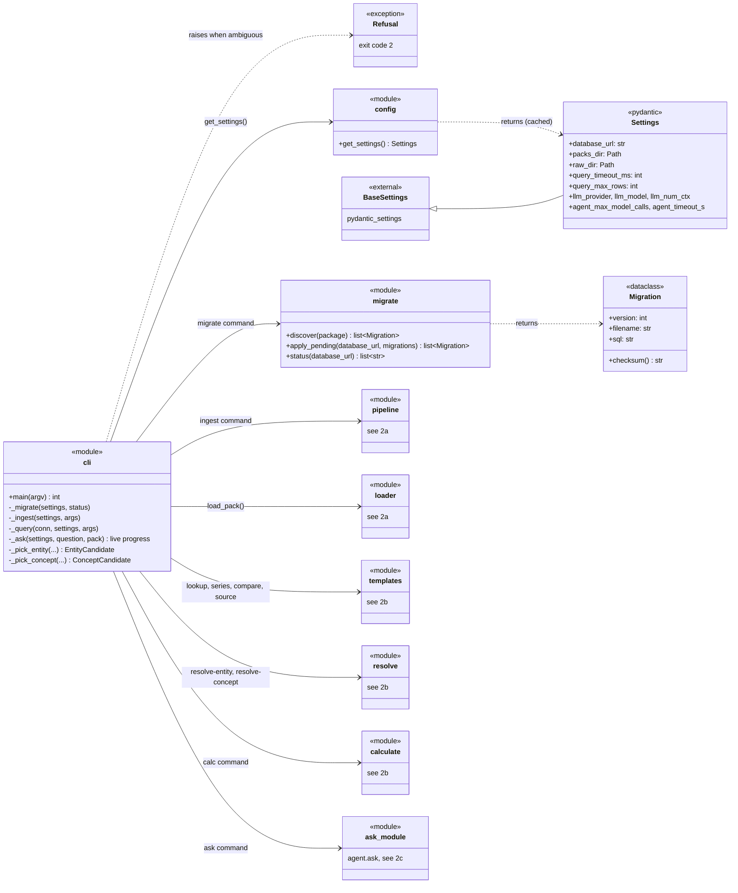
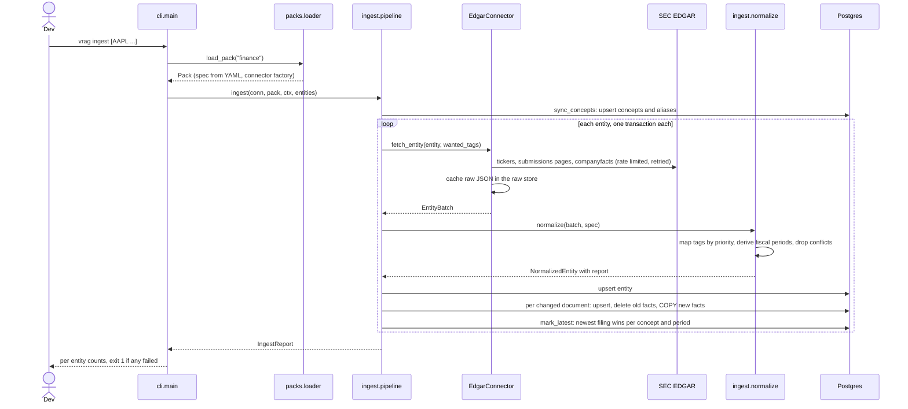
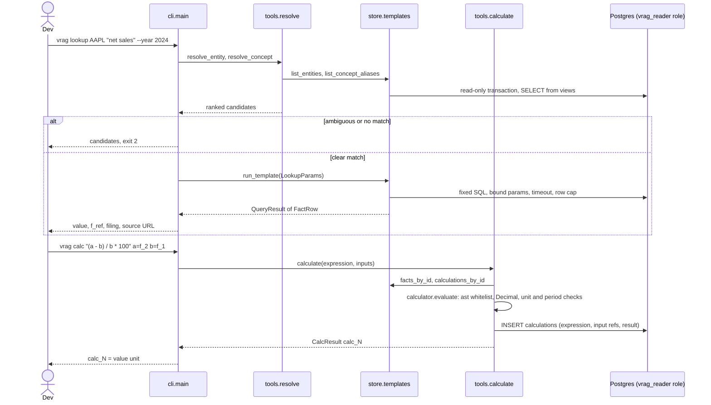
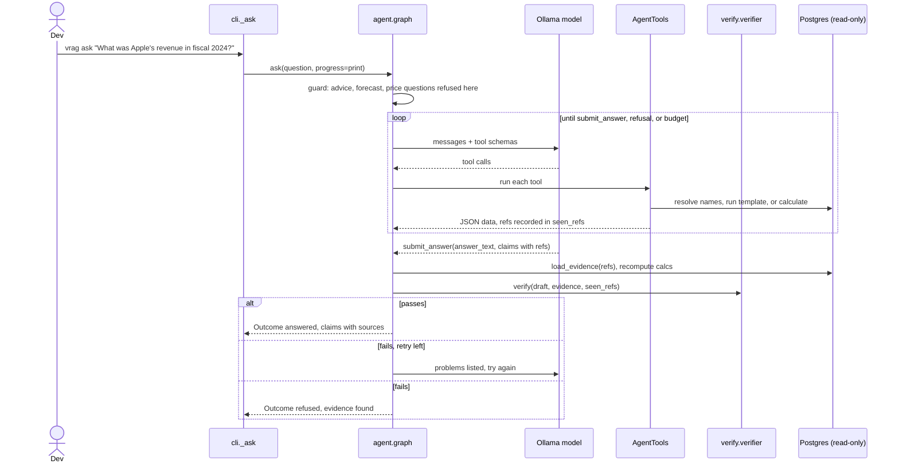
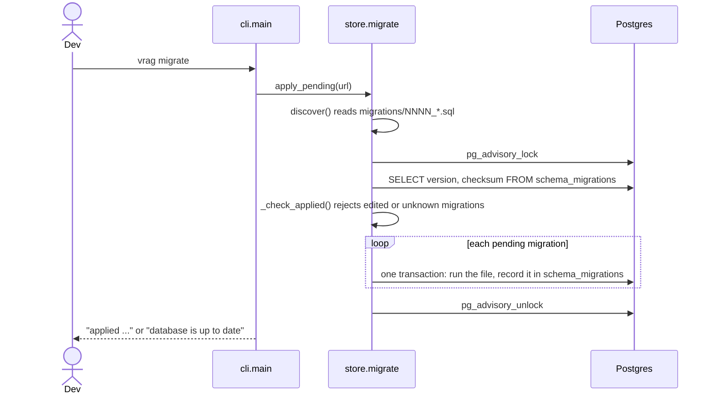
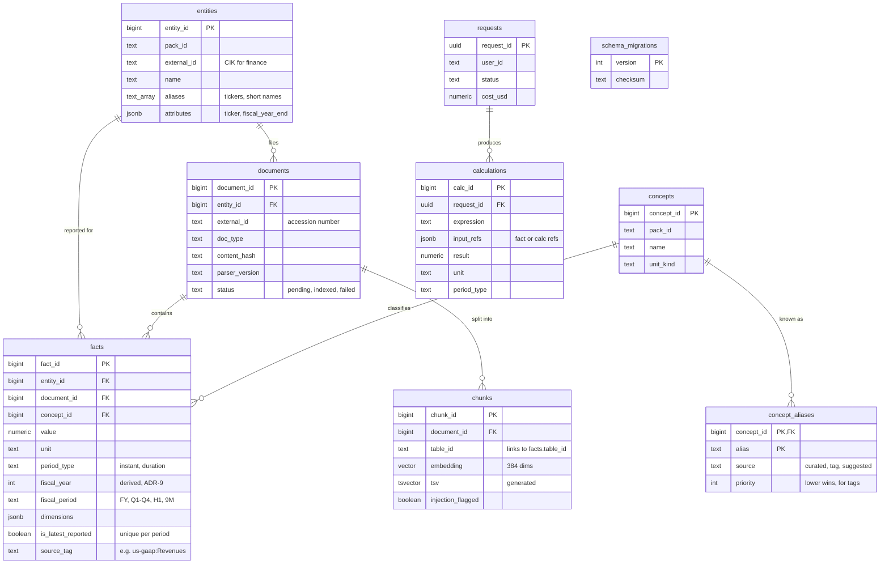

# Code map

How the code fits together: packages, classes, functions, and the calls between them. This file is updated in the same change as the code it describes (rule in [CLAUDE.md](../CLAUDE.md)). For *why* things are designed this way, see [design.md](design.md).

**Last updated:** M2 (agent and verifier).

## Legend

The code is mixed: plain functions for logic, classes for data shapes and swappable interfaces. The diagrams show functions as members of a `<<module>>` box.

| Marker | Meaning |
|---|---|
| `<<module>>` | A Python module. Its "methods" are module-level functions |
| `<<dataclass>>`, `<<pydantic>>` | Data shapes |
| `<<protocol>>` | An interface that packs or providers implement (`typing.Protocol`) |
| `<<external>>` | A third-party class, shown only where our code depends on it |
| `<<pack>>` | Code in `packs/<pack>/`, loaded at runtime, not part of the core |
| `+name` / `-name` | Public / private (leading underscore) |
| `A --> B` | A calls or uses B |
| `A <\|-- B` | B subclasses A |
| `A ..\|> B` | A implements protocol B |
| `A ..> B : returns` | A produces B |
| Dashed grey box (package map) | Planned, not built yet |

## 1. Package map

Which packages exist and which depend on which. Solid boxes are built; dashed boxes are planned, with the milestone that builds them.

## 2. Classes and functions

Built code only. A planned component is added here when its code lands.

### 2a. Ingestion: packs, connector, normalization

### 2b. Query path: database access, templates, tools

Everything the agent will call in M2. `store/` and `tools/` have no LangChain or LangGraph imports.

### 2c. Agent and verifier (M2)

Nodes in `graph.py` are thin; the guard, tools, verifier and evidence loader are plain modules. `verify/` has no LangChain or LangGraph imports.

### 2d. Entry points and configuration

## 3. Key flows

### `vrag ingest`

### `vrag lookup` and `vrag calc`

### `vrag ask`

### `vrag migrate`

## 4. Database schema

From [0001_initial_schema.sql](../src/verified_rag/store/migrations/0001_initial_schema.sql) and [0002_facts_path.sql](../src/verified_rag/store/migrations/0002_facts_path.sql). Key columns only; the SQL files are the source of truth.

**Read-only access.** Role `vrag_reader` (no login) can only `SELECT` from the views `v_entities`, `v_concepts`, `v_concept_aliases`, `v_facts`, and `v_calculations`. `v_facts` joins entity, concept, and document names and hides documents not yet `indexed`. Query templates switch to this role with `SET LOCAL ROLE` inside a read-only transaction. In a hosted database, the app's login role must be granted membership: `GRANT vrag_reader TO <app_role>`.

## Keeping this file current

Update it in the same change whenever you:

- add, rename, or remove a module, public function, class, or Protocol (section 2)
- add or change a dependency between packages, or a package moves from planned to built (section 1)
- add a user-facing flow: a CLI command, an API endpoint, an agent graph path, or an ingestion pipeline (section 3)
- add a migration that changes tables, keys, relationships, views, or roles (section 4)

Private helpers can be left out once a module grows large; public functions and every cross-module call stay. Bump **Last updated** to the current milestone. Check that the diagrams still render (GitHub preview, or VS Code's Markdown preview with a Mermaid extension).
