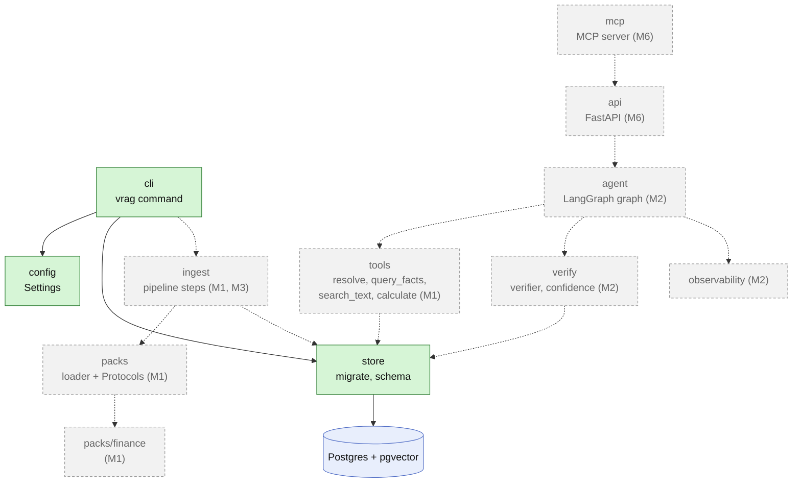
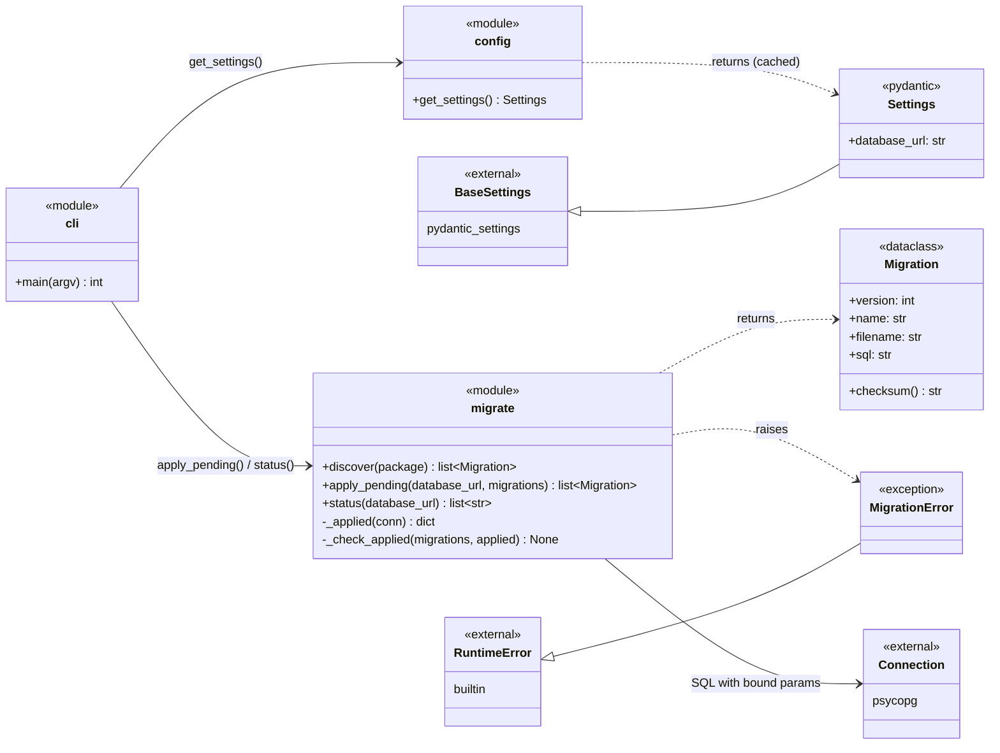
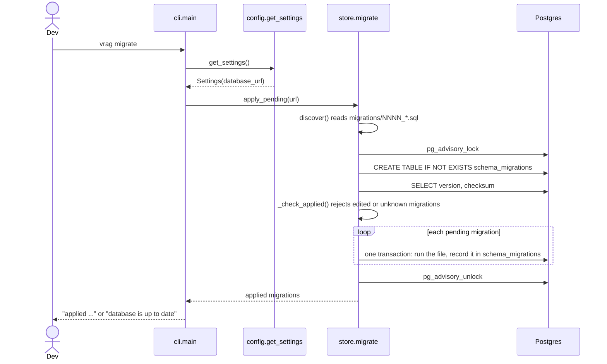
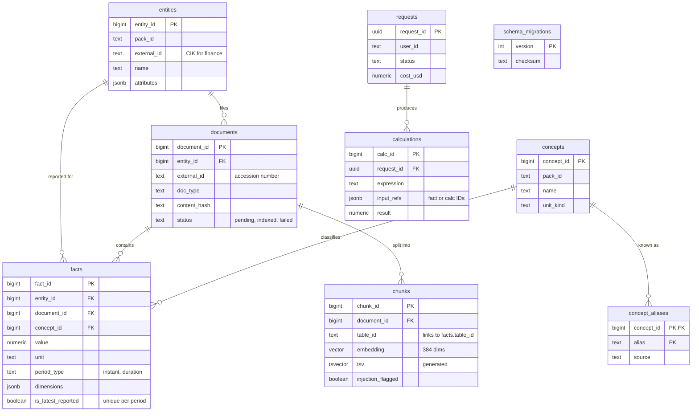

# Code map

How the code fits together: packages, classes, functions, and the calls between them. This file is updated in the same change as the code it describes (rule in [CLAUDE.md](../CLAUDE.md)). For *why* things are designed this way, see [design.md](design.md).

**Last updated:** M0 (repository skeleton).

## Legend

The code is mixed: plain functions for logic, classes for data shapes and swappable interfaces. The diagrams show functions as members of a `<<module>>` box.

| Marker | Meaning |
|---|---|
| `<<module>>` | A Python module. Its "methods" are module-level functions |
| `<<dataclass>>`, `<<pydantic>>` | Data shapes |
| `<<protocol>>` | An interface that packs or providers implement (`typing.Protocol`) |
| `<<external>>` | A third-party class, shown only where our code depends on it |
| `+name` / `-name` | Public / private (leading underscore) |
| `A --> B` | A calls or uses B |
| `A <\|-- B` | B subclasses A |
| `A ..> B : returns` | A produces B |
| Dashed grey box (package map) | Planned, not built yet |

## 1. Package map

Which packages exist and which depend on which. Solid boxes are built; dashed boxes are planned, with the milestone that builds them.

## 2. Classes and functions

Built code only. A planned component is added here when its code lands.

## 3. Key flows

### `vrag migrate`

## 4. Database schema

From [0001_initial_schema.sql](../src/verified_rag/store/migrations/0001_initial_schema.sql). Key columns only; the SQL file is the source of truth.

## Keeping this file current

Update it in the same change whenever you:

- add, rename, or remove a module, public function, class, or Protocol (section 2)
- add or change a dependency between packages, or a package moves from planned to built (section 1)
- add a user-facing flow: a CLI command, an API endpoint, an agent graph path, or an ingestion pipeline (section 3)
- add a migration that changes tables, keys, or relationships (section 4)

Private helpers can be left out once a module grows large; public functions and every cross-module call stay. Bump **Last updated** to the current milestone. Check that the diagrams still render (GitHub preview, or `npx -y @mermaid-js/mermaid-cli -i docs/code-map.md -o <scratch>/out.md`).
