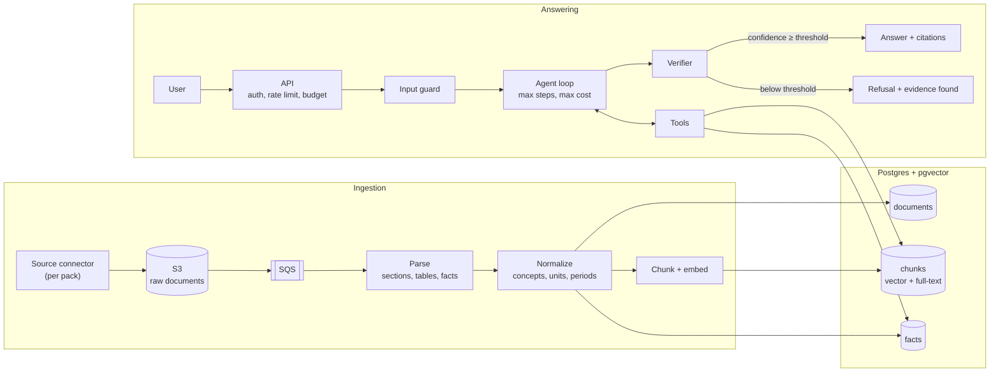

# VerifiedRAG: Design Document

| | |
|---|---|
| **Status** | Draft v0.1 |
| **Author** | Chinmay Lokare |
| **Last updated** | 2026-11-17 |
| **First domain** | SEC financial filings (10-K, 10-Q) |

---

## 1. Summary

VerifiedRAG answers questions over documents that mix prose and structured data. Every number and claim in an answer is traceable to a specific place in a source document. When the system cannot prove an answer from its evidence, it says so instead of guessing.

The core is domain-agnostic. Domain knowledge lives in **domain packs**. The first pack covers SEC financial filings, and a second, smaller pack exists to prove the core is really general.

The headline commitment is a **correctness target**: on questions it chooses to answer, the system is wrong less than 2% of the time. That rate is measured in CI and in production, and alerted on like any other SLO.

## 2. Problem

Public companies file long reports with the SEC: a 10-K every year and a 10-Q every quarter. Each runs 100 to 300 pages of prose, footnotes, and tables. Analysts, auditors, and students regularly ask questions like:

> How did Apple's operating margin change from fiscal 2023 to 2024, and why?

Answering this needs four numbers from the income statement, a calculation, and an explanation from the management discussion section. A general-purpose chatbot answers from memory and can produce confident, plausible, wrong numbers. Naive RAG (chunk, embed, retrieve, generate) does better but still fails often, for these reasons:

1. **Tables break text chunking.** A split or flattened table loses which number belongs to which row and year.
2. **The same figure exists many times.** Revenue appears for every company, every year, every segment, and again when restated. Retrieving the wrong period gives an answer that looks right.
3. **Language models are unreliable at arithmetic.**
4. **Questions need several steps.** Comparisons across companies and years need many lookups.
5. **Users can't check 200 pages,** so the system must check itself and show its evidence.

The same shape of problem appears in insurance policies, clinical trial reports, contracts, and public budgets. That is why the core is general.

## 3. Goals and non-goals

### Goals

- **G1. Traceable answers.** Every number and factual claim links to a source location.
- **G2. Measured correctness.** Wrong-answer rate on answered questions stays under 2%, measured continuously.
- **G3. Honest refusal.** Below a calibrated confidence threshold, the system refuses and shows what evidence it found.
- **G4. Domain-agnostic core.** Adding a domain needs a new pack and no core changes.
- **G5. Production operation.** Deployed on AWS with infrastructure as code, auth, rate and spend limits, tracing, alerts, and a runbook.
- **G6. Real users.** Used by a small real group, whose failure reports become regression tests.

### Non-goals

- Investment advice, forecasts, or opinions on securities.
- Multi-agent orchestration. One bounded agent loop is enough.
- Fine-tuning models.
- Model-written SQL (text-to-SQL) in v1. See [ADR-1](#adr-1-fixed-query-templates-over-model-written-sql).
- Real-time market data.

## 4. Success metrics

All targets are initial and will be revised from measurements. No number goes in the README unless it came from an eval run.

| Metric | Definition | Initial target |
|---|---|---|
| Wrong-answer rate | Wrong answers ÷ answered questions | < 2% |
| Coverage | Answered questions ÷ all questions | Report it; aim for > 75% |
| Citation validity | Citations whose source supports the claim | > 99% |
| Baseline gap | Accuracy vs. a naive RAG baseline on the same questions | Report it |
| P95 latency | End-to-end, multi-step questions | < 10 s |
| Cost per question | Model and infrastructure cost, averaged | < $0.03 |
| Cost per correct answer | Total cost ÷ correct answers | Report it |

## 5. Architecture

### 5.1 Overview

There are two pipelines: **ingestion** prepares documents ahead of time, and **question answering** runs per request. They share one Postgres database.



### 5.2 Design principles

1. **Numbers and prose take different routes.** Figures come from the `facts` table by exact lookup. Explanations come from text search.
2. **The model decides; code computes.** The model chooses tools and inputs. It never does arithmetic and never states a figure that didn't come from a tool result.
3. **Tools take references, not values.** The calculator receives fact IDs, not typed numbers, so the model cannot transpose digits or substitute a remembered figure.
4. **Nothing reaches the user unverified.** Verification is a separate step the agent cannot skip.
5. **The agent is bounded.** Hard caps on steps, cost, and time. Read-only data access.
6. **Prefer structured sources to parsing.** Where a document has machine-readable data (XBRL for SEC filings), use it before extracting tables from layout.
7. **Simplest thing that works.** No framework until plain code becomes the bottleneck.

## 6. Data model

The core schema is domain-neutral. Packs supply the vocabulary that fills it. All tables carry `pack_id`.

```text
entities        (entity_id, pack_id, external_id, name, aliases[], attributes jsonb)
                 -- finance: external_id = CIK, attributes = {ticker, fiscal_year_end}

documents       (document_id, pack_id, entity_id, external_id, doc_type,
                 period_end, filed_at, source_uri, content_hash, parser_version)
                 -- finance: external_id = accession number, doc_type = 10-K | 10-Q

concepts        (concept_id, pack_id, name, description, unit_kind)
                 -- canonical attributes, e.g. revenue, operating_income
concept_aliases (concept_id, alias, source)   -- "Total net sales", us-gaap tag names, ...

facts           (fact_id, pack_id, entity_id, document_id, concept_id,
                 value numeric, unit, scale,
                 period_start, period_end, period_type,   -- instant | duration
                 fiscal_year, fiscal_period,
                 dimensions jsonb,                        -- segment, region; NULL = whole entity
                 is_latest_reported boolean,
                 table_id, row_label, col_label, source_anchor)

chunks          (chunk_id, pack_id, document_id, section, table_id NULL,
                 text, context_header, embedding vector, tsv tsvector)

calculations    (calc_id, request_id, expression, input_refs jsonb, result numeric, unit)

requests        (request_id, user_id, question, status, confidence,
                 cost_usd, latency_ms, trace_id, created_at)
```

### Linking facts and text

Facts and chunks are linked in three ways:

1. **Shared keys.** Entity, document, fiscal period, and section. The agent can find a figure in `facts`, then search text filtered to the same document's management discussion.
2. **Provenance.** Each fact stores `table_id` and `source_anchor`. Each table is also stored as a chunk with the same `table_id`. This gives a two-way link between a number and the table it came from, which citations and the verifier both use.
3. **Source tagging.** SEC filings use inline XBRL, so the financial statements already carry machine-readable tags for concept, period, and unit. Untagged tables (common in the management discussion) fall back to table extraction.

### Restatements and `is_latest_reported`

The same period's figure can appear in several filings, sometimes with different values. For each `(entity, concept, period, dimensions)`, the fact from the most recently filed document is marked `is_latest_reported`. Query templates default to it, and answers say which filing a figure came from.

## 7. Ingestion

Ingestion is an AWS Step Functions workflow per document. Each step is idempotent and keyed by `content_hash` and `parser_version`, so a re-run after a crash, or of an unchanged document, is safe.

1. **Discover.** The pack connector lists new documents. For finance, this is the EDGAR submissions API for a configured list of companies.
2. **Fetch.** Store raw bytes in S3 under `{pack}/{entity}/{document}/`.
3. **Parse.** Split into sections, prose blocks, and tables. Uses Docling for layout and a pack-specific section detector (for example, 10-K Items 1, 1A, 7, 7A, and 8).
4. **Extract facts.** For finance, read XBRL facts first, then extract untagged tables.
5. **Normalize.** Map labels and tags to canonical concepts, convert scale, derive fiscal year and period, and set `is_latest_reported`.
6. **Chunk and embed.** Chunk prose by heading and paragraph. Store each table as its own chunk in markdown. Prepend a context header (entity, document type, period, section) before embedding.
7. **Commit.** Write all rows for the document in one transaction, then mark it `indexed`.

Failures retry with backoff, then go to a dead-letter queue with an alert. Unmapped labels go to a review queue rather than failing ingestion.

### Finance-specific notes

- **Fair access.** The SEC requires a descriptive `User-Agent` with contact details and limits request rates. Both come from configuration, never hard-coded.
- **XBRL source.** v1 takes values from the EDGAR company-facts API, which is easy to use but lacks positions in the document. v2 parses inline XBRL from the filing HTML to get element anchors for precise citations.
- **Fiscal periods.** In the company-facts data, the fiscal year and period fields describe the filing, not necessarily the fact. A 10-K also contains prior-year comparatives. Derive each fact's fiscal period from its start and end dates plus the company's fiscal year end. Verify this against real data before relying on it.
- **Custom tags.** Companies define their own XBRL concepts. Map standard `us-gaap` tags first. For the rest, an LLM suggests a mapping, which is stored with `source = 'suggested'` and spot-checked before use.

## 8. Question answering

### 8.1 Request flow

1. **API.** Authenticate, apply the per-user rate limit, and check the daily spend budget.
2. **Input guard.** Classify the question: in scope, out of scope (advice, forecasts), or abusive. A cheap model handles this, with deterministic rules first.
3. **Agent loop.** Plan, call tools, and observe, until the model submits an answer or hits a limit.
4. **Verifier.** Check every claim and compute a confidence score.
5. **Respond.** Stream the answer with citations, or a refusal with the evidence found.

### 8.2 Agent loop

The loop is plain Python with the model provider's SDK and Pydantic tool schemas.

```python
messages = [system_prompt(pack), user_question]
for step in range(MAX_STEPS):                 # e.g. 8
    reply = model.call(messages, tools=TOOLS)
    for call in reply.tool_calls:             # may be several, run in parallel
        if call.name == "submit_answer":
            return verify(call.input)         # structured draft, see 8.4
        messages.append(run_tool(call))       # validated, logged, budgeted
    check_budget(request)                     # cost and wall-clock caps
return refusal("step limit reached")
```

- **Parallel calls.** Independent lookups run concurrently.
- **Prompt caching.** The system prompt and tool definitions are identical across turns and requests, so they are cached.
- **Retrieved text is untrusted.** Tool results are wrapped and labeled as document content, never as instructions.

### 8.3 Tools

| Tool | Purpose | Backed by |
|---|---|---|
| `resolve_entity(name)` | Name or ticker to `entity_id` | `entities`, alias match, then fuzzy match |
| `resolve_concept(phrase)` | "revenue" to candidate concepts | `concept_aliases`, then embedding match; returns candidates |
| `query_facts(template, params)` | Exact figure lookups | Fixed SQL templates, read-only role |
| `search_text(query, filters)` | Explanations and context | Hybrid search, then reranker |
| `calculate(expression, inputs)` | Arithmetic on fact or calc IDs | Decimal math with unit checks |
| `submit_answer(claims)` | Final structured answer | Goes to the verifier |

#### Query templates

The model never writes SQL. It chooses a template and fills in typed parameters, which are bound as parameters, never concatenated into the query string. All joins live in views and templates written by hand.

| Template | Example question |
|---|---|
| `lookup` | Apple's revenue in fiscal 2024 |
| `time_series` | Apple's revenue from 2020 to 2024 |
| `compare_entities` | Apple vs. Microsoft operating income, 2022 to 2024 |
| `breakdown` | Apple's revenue by segment in 2024 |
| `fact_source` | The table and chunk a fact came from |

Templates run under a database role that can only `SELECT` from specific views, with a statement timeout and a row limit. Questions that fit no template are logged. A new template is added when a pattern recurs.

#### Calculator

```text
calculate(expression="(a - b) / b * 100", inputs={"a": "f_102", "b": "f_101"})
```

1. Load the referenced values from `facts` or `calculations`.
2. Normalize scale (millions vs. thousands).
3. Reject incompatible inputs, such as mixed currencies, or an instant figure combined with a duration figure when that isn't valid.
4. Evaluate with `decimal.Decimal` using a restricted expression parser (no `eval`).
5. Store the result in `calculations` with its input references and return its `calc_id`.

### 8.4 Structured answers

The model submits its answer through the `submit_answer` tool, so the output always has a fixed shape:

```json
{
  "answer_text": "Apple's operating margin rose from 29.82% to 31.51%...",
  "claims": [
    {"text": "Operating margin was 31.51% in fiscal 2024", "type": "numeric", "evidence": ["calc_1"]},
    {"text": "Services carry higher margins than products", "type": "textual", "evidence": ["chunk_55"]}
  ]
}
```

A claim without evidence fails verification automatically.

### 8.5 Verifier

**Numeric claims, checked by code:**
- Load the referenced fact or calculation, and recompute calculations from their inputs.
- Compare the value to the claim text at the claim's stated precision, after unit and scale conversion.
- Check that the stated entity, concept, and period match the evidence metadata.

**Textual claims, checked by a small model, then by code:**
- Ask: "Does this passage support this sentence? Answer supported, partial, or unsupported, and quote the supporting words."
- Confirm the quoted words appear verbatim in the chunk, so the checking model can't invent evidence.

**Outcomes:**
- Unsupported, non-central claims are removed, or the agent gets one retry with the failure reasons.
- If the central claim fails, the response is a refusal.

**Limitation.** The verifier proves that the answer matches the evidence, not that the evidence was the right evidence. For example, a segment figure mislabeled as company-wide can pass. The eval suite and production sampling cover that class of error.

### 8.6 Confidence and abstention

Verifier results combine into a confidence score per answer: numeric checks passed, support strength, how unambiguous concept resolution was, and agent retries. On a held-out calibration set, choose the lowest threshold where the wrong-answer rate on answered questions stays under 2%. Below the threshold, the system refuses.

The threshold is re-derived whenever the model, prompts, or retrieval change, and checked weekly against production samples (see section 11).

## 9. Domain packs

A pack is a folder. Adding a domain must not require core changes. That is the test of the design.

```text
packs/
  finance/
    pack.yaml          # id, display name, entity and document types, metadata fields
    connector.py       # discover and fetch documents
    sections.py        # section detector for the document type
    concepts.yaml      # canonical concepts, units, aliases, tag mappings
    units.yaml         # unit definitions and invalid combinations
    prompt.md          # short domain prompt and tool-usage notes
    eval/
      questions.jsonl  # questions with verified answers and expected evidence
```

**Second pack:** a structurally different domain with public data, such as clinical trial results from ClinicalTrials.gov or a government budget dataset. It needs only a few dozen documents and 30 to 40 test questions. It is built after the finance pack works end to end, and the core is extracted during that refactor. The generic schema isn't designed up front.

Accuracy is reported per pack. Domains without structured tags depend on table extraction and are expected to score lower.

## 10. Safety and security

### Threat model

Mapped to the OWASP Top 10 for LLM Applications (2025).

| Threat | OWASP | Mitigation |
|---|---|---|
| Instructions hidden in ingested documents | LLM01 Prompt injection | Retrieved text is labeled untrusted; tools are read-only; output is verified against evidence; red-team tests in CI |
| Users steering the agent off scope | LLM01 | Input guard; domain prompt; refusal path |
| Fabricated or wrong numbers | LLM09 Misinformation | Facts-only figures, calculator by reference, verifier, calibrated abstention |
| Harmful database queries | LLM05, LLM06 | No model-written SQL; bound parameters; read-only role on views; timeout and row limit |
| Runaway cost or loops | LLM10 Unbounded consumption | Step, cost, and time caps per request; per-user rate limits; daily spend cap with alert |
| One user seeing another's private documents | LLM02, LLM08 | v1 holds public data only. Private uploads need per-tenant filters enforced in SQL, plus isolation tests |
| Leaking the system prompt or secrets | LLM07 | No secrets in prompts; secrets in AWS Secrets Manager; prompt contents assumed public |
| Poisoned concept mappings | LLM04 | Suggested mappings are marked and spot-checked before use |
| Compromised dependencies | LLM03 | Pinned lockfile, dependency scanning in CI, no vendored packages in git |

### Scope boundary

The system answers factual questions about what documents say. It declines forecasts, investment recommendations, and questions about private individuals, and the UI states that it does not give investment advice.

### Red-team suite

A fixed set of adversarial inputs runs in CI:
- injected instructions inside test documents
- out-of-scope requests
- attempts to force SQL-like input through tool parameters
- questions designed to tempt the model into stating remembered figures

## 11. Evaluation

| Layer | What it checks | When |
|---|---|---|
| Unit tests | Calculator, templates, parsers, normalizers, verifier logic | Every commit |
| Component evals | Concept resolution accuracy, retrieval recall@k, table extraction accuracy | Every PR touching that component |
| End-to-end (fast) | About 30 questions: wrong-answer rate, coverage, citation validity | Every PR, and the merge is blocked on regression |
| End-to-end (full) | Full question set, plus the naive RAG baseline for comparison | Nightly and before releases |
| Red-team | Section 10 suite | Every PR |
| Production sampling | Random sample of real answers, verified and labeled weekly | Weekly; alert if the wrong-answer rate exceeds 2% |

### Question sources

- **FinanceBench open-source sample** (150 questions with human-verified answers) is the acceptance test. Some questions reference document types beyond 10-K and 10-Q, so check which documents each question needs and ingest them, or exclude those questions explicitly.
- **Own golden set:** questions targeting known hard cases, such as restatements, fiscal years that don't match calendar years, segments, and multi-company comparisons.
- **User-reported failures:** each confirmed failure becomes a regression test.

### Grading

Numeric answers are graded by tolerance match against the expected value. Textual answers are graded by an LLM judge, which is itself checked against a small set of human-labeled answers before its scores are trusted.

### Baseline

A naive RAG pipeline (chunk, embed, top-k, generate) runs on the same questions so improvements are measured, not asserted.

## 12. Observability and operations

- **Tracing:** one OpenTelemetry trace per request, with a span per model call and tool call, exported to Langfuse. Every response carries a `request_id`.
- **Metrics (CloudWatch):** latency percentiles, cost per request, tokens, refusal rate, tool error rate, ingestion lag and failures, and DLQ depth.
- **Alerts:** error rate, daily spend, DLQ messages, ingestion stalled, and weekly wrong-answer rate above target.
- **Degradation:** if the answer model is unavailable, fall back to an alternative model and record it on the response; if the reranker fails, use fusion order. If verification can't run, refuse. Never return unverified answers.
- **Runbook:** `docs/runbook.md` covers provider outage, parser failure on a new document format, spend spike, and a bad deploy.
- **Postmortems:** real incidents get a short write-up in `docs/postmortems/`.

## 13. Tech stack

| Layer | Choice | Notes |
|---|---|---|
| Language | Python 3.12 | `uv` for dependencies, Ruff, Pyright, pytest |
| API | FastAPI with streamed responses | Same container locally and in AWS |
| Agent | Plain loop, provider SDK, Pydantic | Revisit only if plain code becomes the bottleneck |
| Models | Claude Sonnet 5.5 for answers; Claude Haiku 5.5 for guard, verifier, and mapping suggestions; via Amazon Bedrock | Model IDs and parameters live in config. Keep Haiku prompts under 100K tokens, where its price rises 5x for the whole request. Check current provider docs for parameter restrictions |
| Embeddings and reranking | Bedrock-hosted embedding model and reranker | Pin model versions; store the embedding model version per chunk |
| Parsing | Docling; XBRL data for finance | Vision-model fallback for hard tables only if evals justify it |
| Database | Postgres with pgvector, full-text search | Aurora Serverless v2 in AWS; Docker Compose locally |
| Ingestion | Step Functions, SQS, Lambda; Fargate for heavy parsing | Parsing can exceed Lambda's limits |
| Auth | Amazon Cognito | |
| Secrets | AWS Secrets Manager | Nothing in the repo or environment files |
| Observability | OpenTelemetry, Langfuse, CloudWatch | |
| Infrastructure | Terraform | Every resource; no console-only changes |
| CI | GitHub Actions | Lint, types, tests, evals, red-team, Terraform plan |
| Frontend | Minimal React or Next.js UI | Answer with clickable citations and a "report a problem" button |

## 14. Repository layout

```text
verified-rag/
  CLAUDE.md
  README.md
  pyproject.toml
  docker-compose.yml
  docs/
    design.md
    runbook.md
    adr/
    postmortems/
  src/verified_rag/
    api/          # FastAPI app, auth, rate limits
    agent/        # loop, prompts, budgets
    tools/        # resolve, query_facts, search_text, calculate
    verify/       # verifier, confidence
    ingest/       # workflow steps, chunking, embedding
    store/        # schema, migrations, query templates
    packs/        # pack loader and interface
    observability/
  packs/
    finance/
  evals/
    harness/
    baseline/     # naive RAG for comparison
    redteam/
  infra/          # Terraform
  web/            # frontend
  tests/
```

## 15. Build plan

Each milestone ends with something that runs and is tested.

| # | Milestone | Done when |
|---|---|---|
| M0 | Skeleton | Repo layout, `uv`, Ruff, Pyright, pytest, CI, Docker Compose Postgres with pgvector, schema migrations |
| M1 | Facts path | EDGAR connector for about 10 companies; XBRL facts normalized into `facts`; resolve tools, query templates, calculator; a CLI answers numeric questions correctly |
| M2 | Agent and verifier | Agent loop, `submit_answer`, numeric verification, refusal path; tracing |
| M3 | Text path | Filing HTML parsed into sections and tables; chunks with embeddings; hybrid search and reranker; textual claim verification |
| M4 | Evals | Harness, FinanceBench subset, golden set, naive baseline, CI gate, red-team suite; first honest results table |
| M5 | Calibration | Confidence score, threshold derived on held-out set, wrong-answer and coverage curves |
| M6 | Production | Terraform for everything; API deployed with auth, rate limits, and budgets; alerts; runbook; frontend |
| M7 | Users | Real user group, feedback button, failures becoming regression tests, weekly production sampling |
| M8 | Second pack | Core extracted, second pack shipped, per-pack results |
| M9 | Write-up | Engineering post: baseline, what fixed it, what still breaks, an incident postmortem, cost per correct answer |

If time runs short, M0 to M6 is a complete project. M7 is the biggest differentiator after that.

## 16. Decision log

### ADR-1: Fixed query templates over model-written SQL
Model-written joins can duplicate rows and silently inflate totals while still returning plausible numbers. Templates are reviewable, testable, and immune to SQL injection. **Cost:** questions outside the templates can't use the facts path. **Mitigation:** log misses and add templates for recurring patterns.

### ADR-2: Postgres for vectors, text search, and facts
One store keeps facts, chunks, and metadata joinable in a single query and transaction. **Cost:** Postgres full-text ranking isn't true BM25. **Mitigation:** swap in a BM25 extension or a dedicated search engine if retrieval evals show a gap.

### ADR-3: Structured sources before layout parsing
XBRL tags give exact values, units, and periods. Parsing tables from layout is the fallback, not the default.

### ADR-4: A plain agent loop, not a framework
Six tools and one loop with hard limits are easier to test, trace, and explain. A framework is reconsidered if the loop grows branches that plain code handles poorly.

### ADR-5: The final answer is a tool call
`submit_answer` forces a structured draft with evidence on every claim, which makes verification mechanical rather than a parse of free text.

### ADR-6: Refuse rather than guess
In this domain, a wrong number costs more than no answer. Coverage is a reported tradeoff, not a target to maximize.

## 17. Risks

| Risk | Impact | Mitigation |
|---|---|---|
| Concept mapping errors (similar line items confused) | Wrong but verifiable-looking answers | Candidate lists from `resolve_concept`, ambiguity lowers confidence, golden-set tests |
| Fiscal period mistakes | Wrong year reported | Derive periods from dates; tests on non-calendar fiscal years |
| Table extraction quality outside finance | Lower accuracy in other packs | Report per pack; vision fallback only if evals justify it |
| Model or provider behavior changes | Silent regressions | Pinned model versions; eval gate; recalibrate on change |
| Running cost | Budget overrun | Spend caps, caching, cheap models for high-volume checks, scale-to-zero infrastructure |
| Scope creep | Unfinished project | Milestone order; the second pack is optional |

## 18. Open questions

1. **API hosting:** Lambda with the Lambda Web Adapter and response streaming, or a single Fargate task. Decide in M6 on cost and streaming support.
2. **Company universe:** Which companies and years to ingest, chosen to cover the FinanceBench questions plus the golden set.
3. **Embedding model:** Choose after a small retrieval eval in M3.
4. **Second pack:** Clinical trials or government budgets; decide at M8.
5. **User group:** Who the first users are, and how to recruit them.
