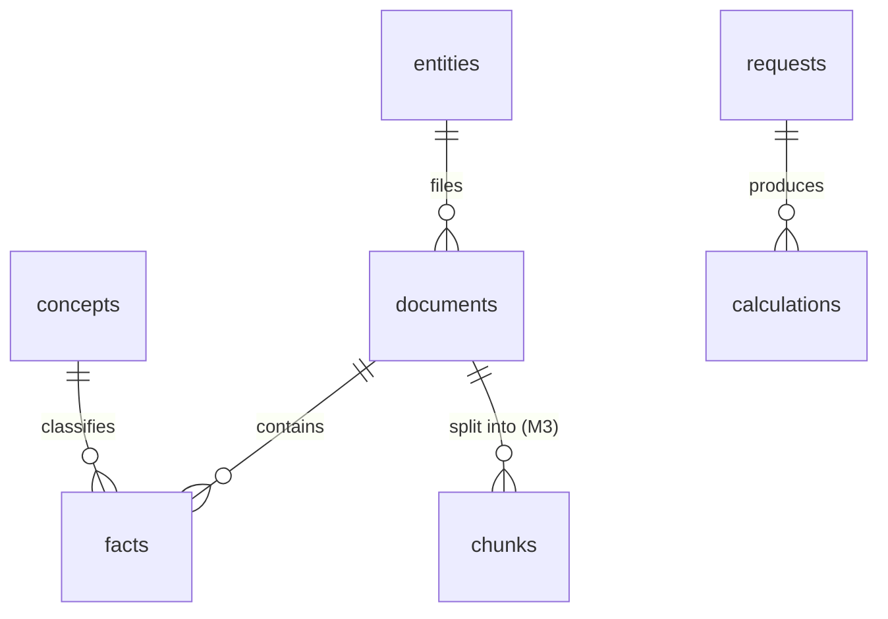

# M0: Repository Skeleton

> **One sentence:** M0 built the empty but working "house" the project lives in: folders, tools, a database, a way to change the database safely, and automatic checks.

**Status:** ✅ Done (commit `5784396`, branch `m0-skeleton`)
**Reading time:** about 8 minutes.

---

## The running example 🏃

The question the whole project answers: *"What was Nike's revenue in fiscal 2024?"* In M0 we can't answer it yet, but we build the **`facts` table** that M1 fills with `51,362,000,000 USD` and M2 reads back.

---

## Level 1 of 4: The tools 🧰 🟢

**🎯 Goal:** know what each tool is for.

| Tool | Job | Why this one |
|---|---|---|
| **uv** | Installs packages, locks exact versions (`uv.lock`) | Fast; the lockfile means everyone gets identical versions |
| **Python 3.12** | Language | Pinned in `.python-version`; uv downloads it |
| **Ruff** | Lint + format | One fast tool for both |
| **Pyright (strict)** | Type checking | Catches bugs before running |
| **pytest** | Tests | The standard |
| **Docker Compose** | Runs Postgres + pgvector locally | Same database for everyone |
| **GitHub Actions** | Runs every check on each push | [ci.yml](../.github/workflows/ci.yml) |

✅ **Check yourself:** what does `uv.lock` guarantee? *(Exact same package versions everywhere.)*

---

## Level 2 of 4: The database 🗄️ 🟢

**🎯 Goal:** know the tables.

[0001_initial_schema.sql](../src/verified_rag/store/migrations/0001_initial_schema.sql) creates the tables from design.md section 6:

| Table | Nike example |
|---|---|
| `entities` | NIKE, Inc. (CIK 0000320187) |
| `documents` | Each 10-K / 10-Q filing |
| `concepts` | `revenue`, `net_income`, … |
| `facts` | 51,362,000,000 USD for FY2024 ⭐ |
| `chunks` | Text pieces with embeddings (M3) |
| `calculations` | `calc_6` = 0.283109 |

**Rules built into the database itself:**
- An `instant` fact can't have a start date (a balance is a point in time).
- Only **one** "latest reported" value per figure and period (a unique partial index).
- Full-text search column `tsv` fills itself in (a generated column).

✅ **Check yourself:** where's the rule "only one latest value" enforced, in Python or in Postgres? *(Postgres, by a unique index, so no code bug can break it.)*

---

## Level 3 of 4: Migrations 🔁 🟡

**🎯 Goal:** know how the database changes safely over time.

**File:** [store/migrate.py](../src/verified_rag/store/migrate.py) · **Decision:** [ADR-8](../docs/adr/0008-plain-sql-migrations.md)

- Numbered SQL files: `0001_…sql`, `0002_…sql`.
- `vrag migrate` applies each **once**, in its **own transaction**, under a **lock** (two runs can't collide).
- Each file's **checksum** is stored. Editing an already-applied file is an **error**: you add a new file instead.

**Why not Alembic?** No ORM in this project; plain SQL reads exactly as Postgres runs it.

✅ **Check yourself:** you need to add a column to `facts`. What do you do? *(Create `0003_….sql`. Never edit 0001 or 0002.)*

---

## Level 4 of 4: Problems we hit ⭐ 🔴

### Problem 1: The database password was "wrong" 🔑
- **Symptom:** `password authentication failed for user "vrag"`.
- **Cause:** **two native Postgres installs** (versions 13 and 17) were already using port 5432, so we were talking to the wrong server.
- **Fix:** the Docker database moved to host port **5433** (changeable with `VRAG_PG_PORT`). Your existing Postgres installs were left untouched.

### Problem 2: `uv` not found 🤷
- **Cause:** it wasn't installed. After installing it with pip, it worked as `python -m uv` but not when a venv was active (the venv's Python doesn't have uv).
- **Fix:** use `python -m uv …` with no venv active, or install uv properly with `winget install astral-sh.uv`.

### Problem 3: Docker wasn't running 🐳
- **Fix:** start Docker Desktop. Later (M1) we added a 5-second connection timeout so this fails fast with a hint.

### Problem 4: Strict types on test code 🧪
- **Cause:** Pyright strict mode flagged untyped database rows in tests.
- **Fix:** small typed helpers (`_returned_id`).

---

## 🗂️ What M0 added

[pyproject.toml](../pyproject.toml) · [docker-compose.yml](../docker-compose.yml) · [.github/workflows/ci.yml](../.github/workflows/ci.yml) · [store/migrate.py](../src/verified_rag/store/migrate.py) · [0001_initial_schema.sql](../src/verified_rag/store/migrations/0001_initial_schema.sql) · [config.py](../src/verified_rag/config.py) · [cli.py](../src/verified_rag/cli.py) (`vrag migrate`) · [docs/code-map.md](../docs/code-map.md) · [ADR-8](../docs/adr/0008-plain-sql-migrations.md) · 8 tests

---

## 🎯 Interview questions and answers

**Q: Why put rules in the database (constraints) and not just in code?**
Code has bugs and many writers; a constraint holds for every writer, forever. "One latest value per period" is a unique partial index, so even a buggy ingest can't break it.

**Q: Why forward-only migrations?**
Down-migrations are rarely tested and often lose data. Fixing forward with a new migration is safer and keeps history honest.

**Q: Why integration tests against a real Postgres instead of mocks?**
The schema leans on Postgres features (pgvector, generated columns, partial unique indexes, roles). A mock would test nothing real. Each test creates and drops its own throwaway database.

---

## 📝 Q&A log (added when you ask about this milestone)

### "How do I test the changes in M0?" (asked 2026-11-18)
1. `docker compose up -d --wait`
2. `python -m uv sync --locked`
3. `python -m uv run ruff check .` · `ruff format --check .` · `pyright`
4. `python -m uv run pytest -v` (integration tests skip if Postgres is down)
5. Manually: `python -m uv run vrag migrate` twice (the second says "up to date"), then `vrag migrate --status`.

### "Is this object-oriented?" (asked 2026-11-18)
**Mixed, on purpose.** Plain functions for logic (calculator, verifier, templates), so they're easy to test. Pydantic models and dataclasses for data shapes. `typing.Protocol` for swappable parts (pack connectors). No inheritance hierarchies. [docs/code-map.md](../docs/code-map.md) shows how everything connects.
