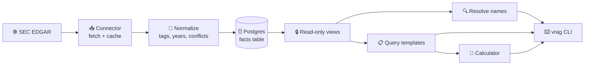
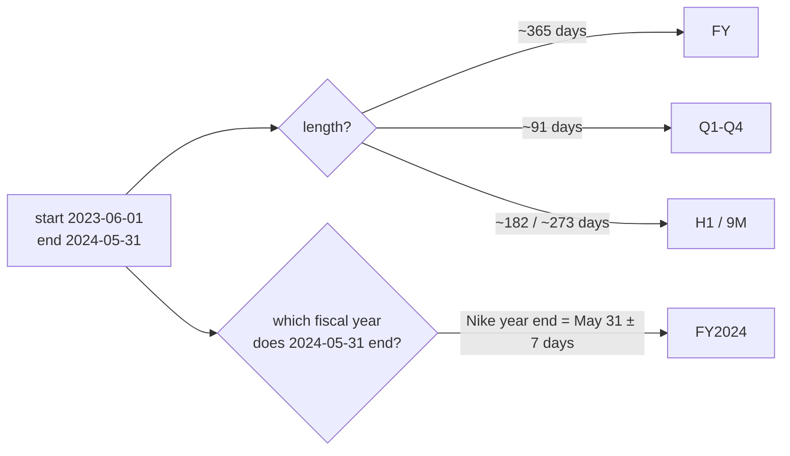

# M1: Facts Path

> **One sentence:** M1 downloads companies' official numbers from the SEC, cleans them, stores them with their source, and lets you look them up and calculate with them, **with no AI involved**.

**Status:** ✅ Done (commit `e567df0`, branch `m1-facts-path`)
**Reading time:** about 20 minutes. Every level ends with a ✅ check.

---

## 🧭 Levels

| Level | Idea | Difficulty |
|---|---|---|
| 1 | The big picture | 🟢 |
| 2 | The rulebook (domain pack) | 🟢 |
| 3 | Fetch from SEC | 🟢 |
| 4 | Clean up (normalize) + fiscal years ⭐ | 🟡 |
| 5 | Store + the read-only lock | 🟡 |
| 6 | Look up: resolve + query templates | 🟡 |
| 7 | Calculator | 🟠 |
| 8 | Problems we hit and how we fixed them ⭐ | 🔴 |
| — | Interview questions and answers | 🎯 |

---

## The running example 🏃

**Nike's revenue for fiscal 2024.** It's the same number M2 answers. Here's how it got into the database.

| Fact | Value |
|---|---|
| Company | NIKE, Inc. (SEC ID, the CIK: `0000320187`, ticker `NKE`) |
| Nike's fiscal year | Ends **May 31** (EDGAR says `0531`) |
| FY2024 period | **2023-06-01 to 2024-05-31** |
| Revenue | **51,362,000,000 USD** |
| XBRL tag | `us-gaap:RevenueFromContractWithCustomerExcludingAssessedTax` |
| Our ID | `f_69552` |

**The interesting part:** three different annual reports contain this same number, and the system picks the newest:

| fact_id | Report | Filed | Value | Latest? |
|---|---|---|---|---|
| 69018 | 10-K for FY2024 | 2024-07-25 | 51,362,000,000 | |
| 69280 | 10-K for FY2025 (repeats FY2024 as comparison) | 2025-07-17 | 51,362,000,000 | |
| **69552** | 10-K for FY2026 (repeats it again) | 2026-07-15 | 51,362,000,000 | ⭐ |

---

## Level 1 of 8: The big picture 🟢

**🎯 Goal:** know the pipeline in one picture.



| Step | Plain words | Where |
|---|---|---|
| Rulebook | What to fetch, and what "revenue" means | [packs/finance/](../packs/finance/) |
| Fetch | Download from SEC | [packs/finance/connector.py](../packs/finance/connector.py) |
| Clean | Pick one value per figure and period, work out the year | [ingest/normalize.py](../src/verified_rag/ingest/normalize.py), [periods.py](../src/verified_rag/ingest/periods.py) |
| Store | Save, mark the newest | [ingest/pipeline.py](../src/verified_rag/ingest/pipeline.py) |
| Lock | Questions can only read | [store/db.py](../src/verified_rag/store/db.py), migration 0002 |
| Look up | Names → IDs → fixed SQL | [tools/resolve.py](../src/verified_rag/tools/resolve.py), [store/templates.py](../src/verified_rag/store/templates.py) |
| Calculate | Math by ID, exact decimals | [tools/calculator.py](../src/verified_rag/tools/calculator.py) |

✅ **Check yourself:** where does any AI appear in M1? *(Nowhere. M1 is pure code.)*

---

## Level 2 of 8: The rulebook (domain pack) 📖 🟢

**🎯 Goal:** know why finance knowledge lives in one folder.

**Rule from CLAUDE.md:** the core code knows nothing about finance. Everything finance-specific is in `packs/finance/`:

| File | Holds | Nike example |
|---|---|---|
| [pack.yaml](../packs/finance/pack.yaml) | Companies, document types | `- ref: NKE` with `aliases: [Nike]` |
| [concepts.yaml](../packs/finance/concepts.yaml) | 31 figures, their XBRL tags **in priority order**, everyday words | `revenue` ← `Revenues`, `RevenueFromContractWith…`, …; words: "net sales", "top line" |
| [units.yaml](../packs/finance/units.yaml) | Accepted units | `USD`, `USD/shares`, `shares`, `pure` |
| [connector.py](../packs/finance/connector.py) | How to download | EDGAR API calls |

**Why?** Design goal G4: adding a new domain (clinical trials, budgets) should need only a new folder.

**Validation on load** ([packs/loader.py](../src/verified_rag/packs/loader.py), [interface.py](../src/verified_rag/packs/interface.py)): one tag can't map to two concepts, and every concept's unit kind must exist.

✅ **Check yourself:** if Nike reports revenue under both `Revenues` and `RevenueFromContract…`, which wins? *(Whichever is listed first in `concepts.yaml`.)*

---

## Level 3 of 8: Fetch from SEC 📥 🟢

**🎯 Goal:** know the 3 SEC endpoints and the politeness rules.

| Step | URL | For Nike |
|---|---|---|
| Ticker → CIK | `sec.gov/files/company_tickers.json` | `NKE` → `320187` |
| Filing list | `data.sec.gov/submissions/CIK0000320187.json` (+ older pages) | 10-K dates, report dates, document links |
| All XBRL numbers | `data.sec.gov/api/xbrl/companyfacts/CIK0000320187.json` | Every value Nike ever tagged |

**SEC fair-access rules:**
- A **User-Agent with your contact email**. It comes from `.env` (`VRAG_FINANCE_SEC_USER_AGENT`), **never** the repo.
- At most 10 requests a second. We use **5**.
- Retries on temporary errors (429, 5xx), with growing waits: 1 s, 2 s, 4 s.

**Cache:** every response is saved in `data/raw/finance/<CIK>/`. `vrag ingest --offline` re-runs from the cache with no network.

**Exact decimals:** JSON floats are read as `Decimal`, so an EPS of `1.23` stays exactly `1.23`.

✅ **Check yourself:** why can't the SEC contact email be in the repo? *(It's personal contact info. CLAUDE.md: no secrets or SEC contact details in the repo.)*

---

## Level 4 of 8: Clean up (normalize) + fiscal years ⭐ 🧹 🟡

**🎯 Goal:** know what goes wrong with raw XBRL and how each problem is handled.

**File:** [ingest/normalize.py](../src/verified_rag/ingest/normalize.py). Pure code, no database.

| Mess in raw data | Fix |
|---|---|
| Two tags for one figure (`Revenues` and `RevenueFromContract…`) | Keep the higher-priority tag |
| The same value listed twice | Collapse to one |
| **Two different values**, same figure and period | **Drop it and report a conflict.** Never guess |
| Wrong unit (EUR) or wrong kind | Skip and count |

### ⭐ The fiscal-year problem

SEC labels **every** value in a 10-K with that report's year, including last year's comparison numbers. Trust the label, and Nike's FY2024 revenue inside the FY2025 report gets called "2025". ❌

**Our rule** ([periods.py](../src/verified_rag/ingest/periods.py), [ADR-9](../docs/adr/0009-fiscal-periods-from-dates.md)) works the year out from **the value's own dates**:



- **±7 days** handles 52/53-week years (Apple's year ends anywhere from Sep 24 to Oct 1).
- A fiscal year is named by the **calendar year it ends in**.
- **Cross-check:** SEC's own label is compared, and mismatches are reported.

✅ **Check yourself:** Nike's Q1 of FY2025: what dates? *(About 2024-06-01 to 2024-08-31. It ends in Aug 2024, which falls in the fiscal year ending May 2025.)*

---

## Level 5 of 8: Store + the read-only lock 🗄️🔒 🟡

**🎯 Goal:** know how saving works and why queries can't write.

### Saving ([ingest/pipeline.py](../src/verified_rag/ingest/pipeline.py))
1. **One transaction per company.** If Nike fails, nothing half-saved, and the others still load.
2. **Fingerprint per filing** (`content_hash`). An unchanged filing is skipped, so re-runs are cheap.
3. **Bulk insert** with Postgres `COPY` (fast).
4. **"Latest reported" ⭐:** for each figure and period, the fact from the **most recently filed** report gets `is_latest_reported = true`. A unique index guarantees only one. That's why `f_69552` (filed 2026) wins over 69018 and 69280.

### The lock ([store/db.py](../src/verified_rag/store/db.py), [migration 0002](../src/verified_rag/store/migrations/0002_facts_path.sql))

Every question-side query runs inside `read_only()`:

```sql
BEGIN;
SET TRANSACTION READ ONLY;                       -- no writes
SET LOCAL ROLE vrag_reader;                      -- can only SELECT views (v_facts...)
SELECT set_config('statement_timeout', '3000', true);  -- 3 second cap
... the query ...  LIMIT 501                     -- row cap (+1 to detect "more exist")
COMMIT;
```

Tests prove that writes fail, that reading the raw `facts` table fails, and that `pg_sleep(1)` with a 100 ms cap gets cancelled.

✅ **Check yourself:** what stops a query from deleting facts? *(Three things: the read-only transaction, the reader role having only SELECT on views, and fixed SQL with no free-form queries.)*

---

## Level 6 of 8: Look up: resolve + query templates 🔍 🟡

**🎯 Goal:** know how "Nike" and "net sales" become a number.

### Step 1: Resolve words to IDs ([tools/resolve.py](../src/verified_rag/tools/resolve.py))

Real output:

```
> vrag resolve-entity "nike"
1.00  NIKE, Inc.  (id 4, matched 'Nike')

> vrag resolve-concept "net sales"
1.00  revenue     (id 1, matched 'net sales')
0.71  net_income  (id 11, matched 'net loss')
```

- Exact match first (ignoring case and punctuation) → score 1.00. Then fuzzy matching.
- It returns a **ranked list**, never one silent pick. `unambiguous()` accepts only a clear winner.

### Step 2: A fixed query template ([store/templates.py](../src/verified_rag/store/templates.py))

| Template | Example |
|---|---|
| `lookup` | Nike revenue FY2024 |
| `time_series` | Nike revenue 2023 to 2024 |
| `compare_entities` | Nike vs. Walmart revenue, 2023 to 2024 |
| `breakdown` | by segment (data arrives in M3) |
| `fact_source` | where `f_69552` came from |

Parameters are **typed Pydantic models** (years must be 1990 to 2100, periods FY or Q1–Q4…) and are **bound**, never pasted into the SQL. So no SQL injection, and no AI-written SQL (ADR-1).

Real output:

```
> vrag lookup NKE revenue --year 2024
f_69552  NIKE, Inc.  revenue  FY2024 FY  51,362,000,000 USD  (2023-06-01 to 2024-05-31)
         source: 10-K 0000320187-26-000088, filed 2026-07-15
         tag: us-gaap:RevenueFromContractWithCustomerExcludingAssessedTax  latest reported: True
         https://www.sec.gov/Archives/edgar/data/320187/000032018726000088/nke-20260531.htm
```

✅ **Check yourself:** what does `vrag` do if you type "income" and it matches 3 figures equally? *(It exits with code 2 and shows the candidates. It refuses rather than guesses.)*

---

## Level 7 of 8: Calculator 🧮 🟠

**🎯 Goal:** understand "math by reference".

**Files:** [tools/calculator.py](../src/verified_rag/tools/calculator.py) (pure math), [tools/calculate.py](../src/verified_rag/tools/calculate.py) (database side)

Real output, Nike revenue growth FY2023 → FY2024:

```
> vrag calc "(a - b) / b * 100" a=f_69552 b=f_69279
calc_6 = 0.283109 pure
```

That's (51,362,000,000 − 51,217,000,000) ÷ 51,217,000,000 × 100 ≈ **0.28%**.

What happens inside:
1. Load the real values for `f_69552` and `f_69279`. **You pass IDs, never numbers.**
2. Parse the expression with Python's `ast` module, allowing **only** `+ - * / **` and parentheses. No `eval`, so `__import__('os')` is rejected.
3. Exact `Decimal` math (`0.1 + 0.2` gives exactly `0.3`).
4. **Unit checks:** USD − USD ✅, USD ÷ USD gives a ratio ✅, USD + EUR ❌.
5. **Period checks:** a balance (a point in time) + revenue (a period) ❌.
6. Save as `calc_6` with its inputs, so it can feed the next calculation and the verifier can **re-do** it (M2).

✅ **Check yourself:** why pass `f_69552` instead of `51362000000`? *(So nobody, human or AI, can mistype or invent the number.)*

---

## Level 8 of 8: Problems we hit and how we fixed them ⭐ 🔴

### Problem 1: Johnson & Johnson's years were all off by one 📅
- **Found by:** the cross-check on the first real ingest showed **1,656 mismatches** for J&J.
- **Cause:** EDGAR lists J&J's year end as `0103` (Jan 3), because it uses 52/53-week calendar-style years. Read literally, the year ending Dec 31, 2023 lands *before* the Jan 3 cutoff, so the rule counted it in 2024. ❌
- **Fix:** a year end in the **first 7 days of January** is treated as Dec 31. A test was added, and the normalizer version bumped so everything was recomputed.
- **Result:** 1,656 → **0**.

### Problem 2: Walmart showed 423 mismatches, but we were right 🛒
- **Investigated:** all 423 were in **2009–2014** filings. From 2014 on, SEC's labels match ours.
- **Conclusion:** SEC's older labels used the "year it started" convention. **No fix needed.** It's documented in ADR-9.
- **Lesson:** a failing check isn't always a bug in your code. Look at *where* the failures are.

### Problem 3: `vrag lookup` hung forever ⏳
- **Cause:** Docker Desktop was off (after a reboot), and the database connection had **no timeout**.
- **Fix:** a 5-second connect timeout plus a friendly hint: *"is Docker running? Try: docker compose up -d"*.

### Problem 4: `vrag` "not recognized" 🤷
- **Cause 1:** `vrag` lives inside the project's environment, so it has to be run via `python -m uv run vrag …` from the project folder.
- **Cause 2:** the example company `EXMP` exists **only inside the tests** (a temporary database), not in the real one.

### Problem 5: A conflicting value shouldn't be guessed 🤔
- **Design decision:** when one filing reports two different values for the same thing (the test company's gross profit: 500 and 510), the system **drops it and reports a conflict**. Real data: 0 conflicts across all 10 companies.

### Problem 6: Real figures typed from memory in test files 🧠
- **Found in M2:** some calculator tests used real Apple numbers from memory.
- **Fix:** replaced with made-up numbers. The rule is now in CLAUDE.md.

✅ **Check yourself:** tell Problem 1 as symptom → cause → fix → result.

---

## 🗂️ Every file M1 added

| File | Purpose | Level |
|---|---|---|
| [packs/finance/pack.yaml, concepts.yaml, units.yaml](../packs/finance/) | The rulebook | 2 |
| [packs/finance/connector.py](../packs/finance/connector.py) | EDGAR download, cache, retries | 3 |
| [packs/interface.py](../src/verified_rag/packs/interface.py), [loader.py](../src/verified_rag/packs/loader.py) | Pack shapes and loading | 2 |
| [ingest/periods.py](../src/verified_rag/ingest/periods.py) | Fiscal year and period from dates | 4 |
| [ingest/normalize.py](../src/verified_rag/ingest/normalize.py) | Tag priority, conflicts, hashing | 4 |
| [ingest/pipeline.py](../src/verified_rag/ingest/pipeline.py) | Write to DB, mark latest | 5 |
| [store/db.py](../src/verified_rag/store/db.py) | `connect()`, `read_only()` | 5 |
| [store/migrations/0002_facts_path.sql](../src/verified_rag/store/migrations/0002_facts_path.sql) | Views, reader role | 5 |
| [store/templates.py](../src/verified_rag/store/templates.py) | 5 query templates | 6 |
| [tools/resolve.py](../src/verified_rag/tools/resolve.py) | Names → candidates | 6 |
| [tools/calculator.py](../src/verified_rag/tools/calculator.py), [calculate.py](../src/verified_rag/tools/calculate.py) | Math by reference | 7 |
| [refs.py](../src/verified_rag/refs.py) | `f_12` / `calc_3` parsing | 7 |
| [cli.py](../src/verified_rag/cli.py) | `ingest`, `lookup`, `series`, `compare`, `calc`, `source`, `resolve-*` | 6 |
| [ADR-9](../docs/adr/0009-fiscal-periods-from-dates.md) | Fiscal-year rule + validation | 4 |

**Dependencies added:** `httpx` (HTTP with timeouts, and a mock transport for tests), `pyyaml` (pack files), `types-pyyaml` (type hints).

**Tests:** a made-up company "Example Corp" in [tests/fixtures/edgar/](../tests/fixtures/edgar/) packs in every hard case: a restatement (1,000 → 1,010), a 53-week year, a duplicate tag, a conflict, a EUR value, an 8-K, and an old index page.

---

## 🎯 Interview questions and answers

**Q: Why not just embed the filings and use RAG for numbers?**
Text chunking breaks tables, the same figure appears for many years and segments, and LLMs are bad at arithmetic. Numbers come from structured XBRL by exact lookup, and only explanations use text search (M3).

**Q: How do you handle restatements?**
Every reported value is kept. For each figure and period, the fact from the most recently filed document is marked `is_latest_reported`, which a unique partial index enforces. Answers cite which filing the number came from.

**Q: What was the hardest bug?**
Fiscal years. SEC's labels describe the filing, not the fact. We derive years from dates with a 52/53-week tolerance, cross-check against SEC's labels, and that cross-check caught a real bug: J&J's `0103` year end shifted every year by one (1,656 mismatches → 0).

**Q: How is the data path secured?**
No model-written SQL. Fixed templates with typed, bound parameters, run in a read-only transaction under a role that can only SELECT specific views, with a statement timeout and a row cap.

**Q: Why derive fiscal periods instead of trusting the source?**
Because the source field is about the filing. A 10-K includes two prior years labelled with the current year. Trusting it would mislabel comparatives and break restatement handling.

---

## 📝 Q&A log (added when you ask about this milestone)

### "Help me understand what you've implemented in M1" (asked 2026-11-23)
Answered by Levels 1–7 above (the 6-step walkthrough: rulebook → fetch → clean → store + lock → look up → calculate).

### "`vrag lookup EXMP …` says 'vrag' is not recognized" (asked 2026-11-23)
See Problem 4. Run it from the project root as `python -m uv run vrag …`. `EXMP` is a test-only company, so use a real one like `NKE`.

### "The ingest command hangs with no output" (asked 2026-11-23)
See Problem 3. Start Docker Desktop, then `docker compose up -d`. Since that fix, it fails in 5 seconds with a hint instead of hanging.
