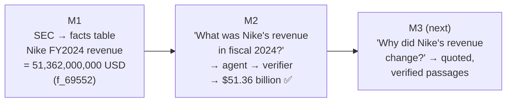

# Interview Prep: Milestone Implementation Notes

**What this folder is:** a plain-language walkthrough of everything built so far, milestone by milestone, written for interview revision.

**How each doc is built (flow-friendly):**
- 🎯 One idea per level, each with a goal stated up front
- 🟢 → 🔴 Levels get harder slowly
- ✅ A quick "check yourself" question at the end of every level
- 🏃 **One running example across all milestones:** *Nike's revenue in fiscal 2024*, with real values from our database
- ⭐ A **Problems & fixes** section (symptom → cause → fix → result) that works as an interview story bank
- 🎯 Interview Q&A at the end
- 📝 A **Q&A log**: any question you ask about a milestone later gets answered and added there

---

## Milestones

| | Milestone | One sentence | Doc |
|---|---|---|---|
| ✅ | **M0** Skeleton | Tools, database, safe migrations, CI | [M0-skeleton.md](M0-skeleton.md) |
| ✅ | **M1** Facts path | SEC numbers → cleaned → stored → looked up and calculated, no AI | [M1-facts-path.md](M1-facts-path.md) |
| ✅ | **M2** Agent + verifier | A small AI fetches numbers with tools; code checks every number | [M2-agent-and-verifier.md](M2-agent-and-verifier.md) |
| ⏭️ | M3 Text path | Answer "why" questions with verified quotes from filings | *added when built* |
| | M4 Evals | FinanceBench, golden set, baseline, CI gate | |
| | M5 Calibration | Confidence score and refusal threshold | |
| | M6 Production | AWS, auth, MCP server, frontend | |

---

## The running example across milestones 🏃

---

## 60-second project pitch 🎤

> VerifiedRAG answers questions over SEC filings where **every number is traced to its source and checked by code**. Numbers come from structured XBRL data by exact lookup, not from the model's memory. The model only *chooses* tools; a calculator does math by reference, and a deterministic verifier checks every number in the answer at its written precision before anything is returned. If verification fails, it refuses and shows the evidence it found. I measure it with an eval harness. On a free 3B local model it answered 75% of answerable questions with zero wrong answers, after I redesigned the tools to suit a small model.

---

## Where else to look
- [docs/design.md](../docs/design.md): the full design
- [docs/code-map.md](../docs/code-map.md): diagrams of how the code connects
- [docs/adr/](../docs/adr/): why each big decision was made
